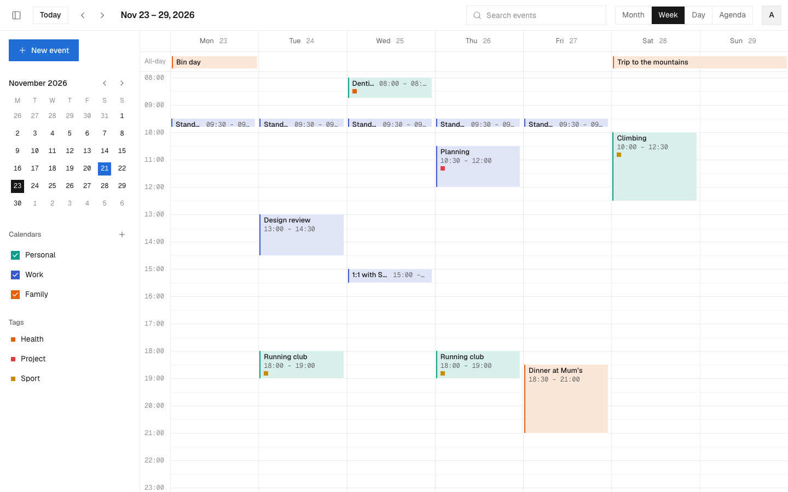
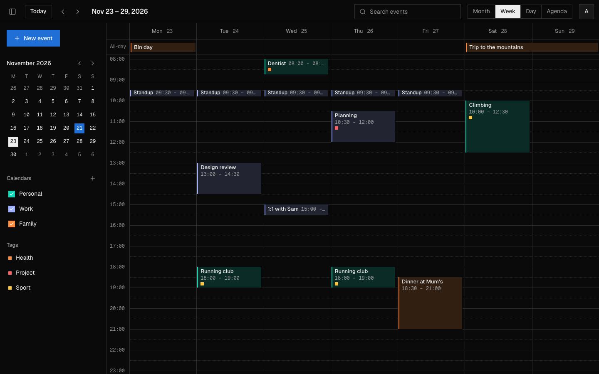
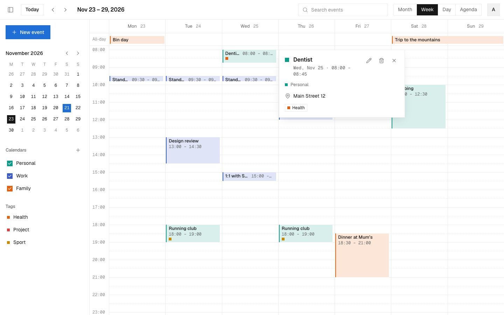
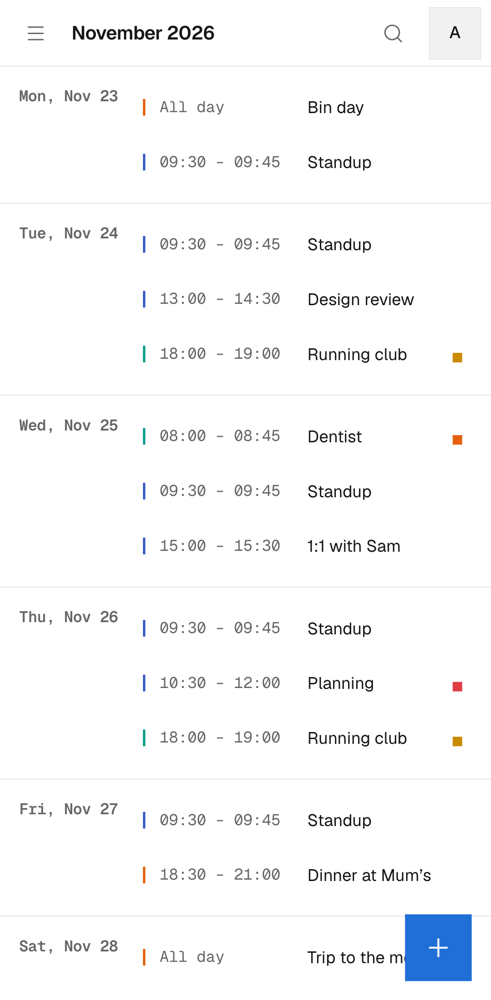

# K-Calendar

A small, self-hosted personal calendar: month, week, day and agenda views, repeating events, reminders by push notification and e-mail, and import and export as iCalendar files. It runs in any browser and installs on phones as a web app (PWA). A few people can have accounts on one instance, but nothing is shared between them: every calendar belongs to one person. One container keeps everything in one directory, so a backup is a copy of that directory.



| Dark theme | An event's details | On a phone |
| --- | --- | --- |
|  |  |  |

## Features

- Several calendars per person, each with its own colour and each easy to hide; coloured tags across calendars.
- Events with a time zone, all-day events over several days, location, description and an own colour.
- Repeating events, from "every weekday" to "the last Friday of every month", changed as "this event", "this and following events" or "all events".
- Drag to move and resize, drag over empty time to create, search that ignores case and accents.
- Reminders by Web Push and by e-mail, delivered once even across restarts.
- Import an `.ics` file, export a calendar, a secret feed address per calendar for other apps, and read-only subscriptions to calendars on the internet, such as public holidays.
- Installable app; what was loaded stays readable offline.
- Accounts: first-run setup, invite links, optional open registration, password reset, two-step verification (TOTP) with recovery codes, optional single sign-on through OIDC.
- Personal API tokens with read or read and write access.
- Light and dark theme.

Not included on purpose: sharing calendars or events with other people, CalDAV and two-way sync with Google or Microsoft, attendees and invitations, tasks, creating or changing events while offline, a year view.

## Quick start

You need Docker with Compose, a domain name pointing at the machine, and a reverse proxy that provides HTTPS (see [HTTPS](#https)). Browsers allow installing the app and push notifications only over HTTPS.

1. Get the example Compose file and create the data directory. The container runs as user 1000, so that user has to own it:

   ```sh
   mkdir calendar && cd calendar
   curl -fsSLO https://raw.githubusercontent.com/K-cermak/K-Calendar/main/docker-compose.yml
   mkdir data && sudo chown 1000:1000 data
   ```

2. In `docker-compose.yml`, set `APP_BASE_URL` to the address people will use, such as `https://calendar.example.com`. It must match exactly: the server uses it for links and to refuse requests from other sites. Fill in the SMTP lines if you want reminders and links by e-mail.
3. Start it:

   ```sh
   docker compose up -d
   docker compose logs -f   # optional: watch it start
   ```

4. Set up HTTPS as below, open the address in a browser and create the first account, which becomes the administrator.

To add people, open **Administration** from the account menu and create an invite link. With SMTP set up, the link can go out by e-mail; otherwise pass it on yourself.

On a phone, open the address and use **Add to Home Screen** (Safari: Share → Add to Home Screen; Chrome: the install prompt or the menu). On iPhones, push notifications work only for the app on the home screen.

### Updating

```sh
docker compose pull && docker compose up -d
```

Database migrations run by themselves when the new version starts. Open apps offer to reload into the new version.

## Configuration

All settings are environment variables. Only `APP_BASE_URL` is required. The server checks them at startup and stops with a message that names the variable if one is wrong.

| Variable | Default | Meaning |
| --- | --- | --- |
| `APP_BASE_URL` | (required) | Public address, such as `https://calendar.example.com`, with no path |
| `APP_DATA_DIR` | `/data` | Where the database and the generated secret key live |
| `APP_SECRET_KEY` | generated | At least 32 characters. If unset, one is generated on first start and kept in `APP_DATA_DIR/secret.key`. Changing it makes two-step verification secrets unreadable |
| `APP_TRUSTED_PROXIES` | | Comma-separated addresses or networks of reverse proxies whose `X-Forwarded-*` headers are believed |
| `APP_SMTP_HOST`, `APP_SMTP_PORT` | | Mail server. E-mail is on when the host and `APP_SMTP_FROM` are set |
| `APP_SMTP_USER`, `APP_SMTP_PASSWORD` | | Sign-in at the mail server, if it needs one |
| `APP_SMTP_FROM` | | Sender address |
| `APP_SMTP_SECURITY` | `starttls` | `starttls`, `ssl` or `none` |
| `APP_OIDC_DISCOVERY_URL` | | The provider's `.well-known/openid-configuration` URL |
| `APP_OIDC_CLIENT_ID`, `APP_OIDC_CLIENT_SECRET` | | Single sign-on is on when all three OIDC variables are set |
| `APP_OIDC_PROVIDER_NAME` | `SSO` | Label of the sign-in button |
| `APP_OIDC_AUTO_PROVISION` | `false` | Create accounts for people the provider knows but the app does not |
| `APP_PASSWORD_LOGIN_ENABLED` | `true` | `false` allows sign-in only through OIDC, which must then be configured |
| `APP_VAPID_PUBLIC_KEY`, `APP_VAPID_PRIVATE_KEY` | generated | Keys for push notifications, generated on first start and kept in the database. Set both only to bring keys from elsewhere; changing them stops push on every device until it is turned on again |
| `APP_VAPID_CONTACT` | from `APP_SMTP_FROM` or `APP_BASE_URL` | Contact address sent to push services, as `mailto:` or `https:` |
| `APP_ALLOW_PRIVATE_SUBSCRIPTION_URLS` | `false` | Allow subscribing to calendars on private networks, such as another server at home |
| `APP_LOG_LEVEL` | `info` | `debug`, `info`, `warning`, `error` or `critical` |

In the OIDC provider, register `https://calendar.example.com/api/v1/auth/oidc/callback` (with your address) as the redirect URI. A person who signs in through OIDC is matched to an account by the provider's user ID, or by a verified e-mail address the first time; people can also link and unlink their account under Settings → Security.

## HTTPS

The container speaks plain HTTP on port 8000. Put a reverse proxy in front of it that handles HTTPS, and run exactly one container: reminders are sent by a loop inside the server process, and SQLite has a single writer.

[Caddy](https://caddyserver.com/) gets a certificate by itself:

```caddy
calendar.example.com {
	reverse_proxy 127.0.0.1:8000
}
```

The example Compose file publishes the port on `127.0.0.1` only, so the calendar is reachable from outside only through the proxy. If the proxy runs in Docker too, point it at the container by its service name (`calendar:8000`) and remove the `ports` section. Either way, `APP_TRUSTED_PROXIES` must cover the address the proxy connects from, so that sign-in throttling and the session list see people's real addresses.

## Backup and restore

Everything lives in the data directory: the SQLite database and the generated secret key.

```sh
docker compose stop
cp -a data "backup-$(date +%F)"
docker compose start
```

Stop the container first, so the database is not copied halfway through a write. To restore, stop the container, replace `data` with the backup and start it again.

Once a night the server deletes expired sign-ins, used or expired invite links and the delivery log of reminders older than a month. It makes no backups itself.

## Administration from the command line

For a locked-out administrator, or when no one else can help:

```sh
docker compose exec calendar python -m app.cli reset-password someone@example.com   # prints a one-time reset link
docker compose exec calendar python -m app.cli disable-totp someone@example.com     # turns off two-step verification
docker compose exec calendar python -m app.cli make-admin someone@example.com       # grants admin rights
```

## REST API

Create a token under Settings → API tokens, with read or read and write access. A token works for calendars, events and tags, never for account, security or admin settings.

```sh
curl -H "Authorization: Bearer $TOKEN" \
     "https://calendar.example.com/api/v1/occurrences?start=2027-02-01&end=2027-02-08"
curl -H "Authorization: Bearer $TOKEN" -H "Content-Type: application/json" \
     -d '{"calendar_id": 1, "title": "Dentist", "start": "2027-02-03T08:00:00", "end": "2027-02-03T08:45:00"}' \
     https://calendar.example.com/api/v1/events
```

Times without an offset are wall-clock times in the event's zone, which defaults to the zone in your profile. The full reference is at `/api/docs` on your instance.

## Adding a translation

1. Copy `frontend/src/locales/en.json` to `frontend/src/locales/<code>.json`, for example `de.json`, and translate the values. Keep the keys.
2. Add the language to `LOCALES` in `frontend/src/i18n.ts`, under the same code, with its name in that language: `{ en: 'English', de: 'Deutsch' }`.
3. For e-mails and push notifications, copy `backend/app/locales/en.json` to `backend/app/locales/<code>.json` and translate it too. Keys that are missing fall back to English.

People can then pick the language under Settings → Profile.

## Development

You need Python 3.15 with [uv](https://docs.astral.sh/uv/), Node 26 with pnpm 12, [just](https://just.systems/) and Docker.

```sh
just setup                                                      # install dependencies of both sides
cd frontend && pnpm exec playwright install chromium && cd ..   # once, for end-to-end tests
just dev                                                        # backend on :8000 and Vite on http://localhost:5173
```

Open http://localhost:5173 exactly: `127.0.0.1` is a different address to the browser, and the server refuses changes from it. `just dev` keeps its data in `backend/.data`. Other recipes:

| Command | |
| --- | --- |
| `just check` | Lint, type checks and unit tests of both sides, as CI runs them |
| `just fmt` | Format both sides |
| `just test-e2e` | Build the image and run the Playwright tests against it, on a desktop and a phone viewport |
| `just api-types` | Regenerate the frontend's API types after changing the API |
| `just docker` | Build the image |
| `just screenshots` | Render the screenshots in this README from the built image |
| `just icons` | Render the app icons from `frontend/public/icon.svg` |

The app's name lives only in `branding.json`. How it is built and why is described in [docs/SPEC.md](docs/SPEC.md). See [CONTRIBUTING.md](CONTRIBUTING.md) before sending changes.

## License

MIT, see [LICENSE.md](LICENSE.md).
